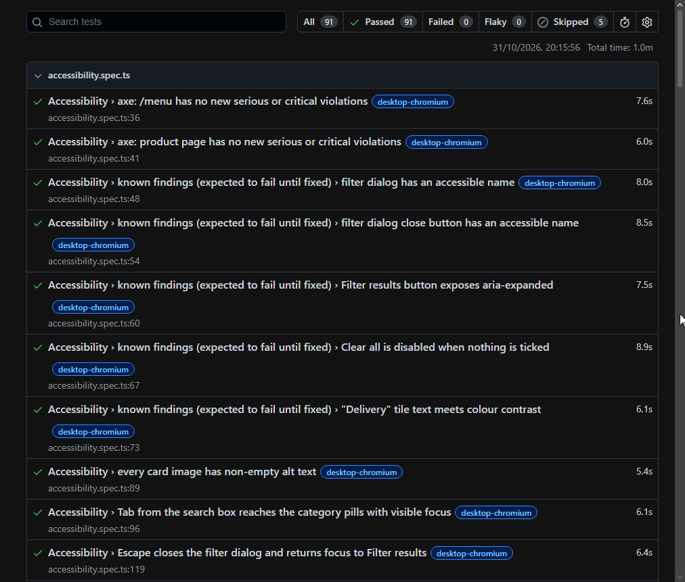

# Greggs-Testing

[](https://github.com/RobH-QA/Greggs-Testing/actions/workflows/playwright.yml)

8 specs · 48 tests × 2 projects · about 1 minute locally

A Playwright + TypeScript test suite for the Menu section of [greggs.com](https://www.greggs.com/menu).

## Testing Purpose

Making sure the only thing flaky is the pastry.

## What's tested

| Spec | What it proves |
| --- | --- |
| `navigation.spec.ts` | `/menu` loads; each category pill sets `?category=` and shows only that section; deep links work; a card opens its product page; browser Back restores the category. |
| `search.spec.ts` | Live search for "steak" returns only matching cards; removing the "Search: steak" chip restores the full menu; a term with no matches shows the empty state. |
| `filters.spec.ts` | A category filter shows only that section; "No Milk" sets the badge to 1, and the first three results don't list Milk on their product pages; "Clear all" restores the full menu and removes the badge. |
| `data-consistency.spec.ts` | Card counts for each category pill match the "(n)" counts in the filter dialog, and "All" equals their sum; no category has duplicate or empty card names; every card image loads. |
| `product-detail.spec.ts` | For the first product in each category, the traffic-light summary matches the nutrition table's per-portion column, the "Typical values per 100g/ml" line matches the per-100 column for energy, and an allergen line is present. |
| `responsive.spec.ts` | On mobile the header nav collapses behind a Menu button and the grid has fewer columns than on desktop; neither viewport scrolls horizontally; the pill row scrolls within its own container; the filter dialog fits the mobile viewport. |
| `accessibility.spec.ts` | axe finds no new serious or critical violations on `/menu` or a product page; every card image has alt text; Tab reaches the pills with a visible focus ring; Escape closes the filter dialog and returns focus to the button. Known defects are tracked as expected failures. |
| `performance.spec.ts` | `/menu` reaches DOMContentLoaded in under 10s and load in under 15s; card images are lazy-loaded. |

## Project structure

| Path | Purpose |
| --- | --- |
| `tests/fixtures.ts` | Extends `test` with the `menuPage` fixture: opens `/menu`, accepts the cookie banner, and waits for a product card. Every spec imports `test` and `expect` from here. |
| `tests/pages/` | Thin page objects (`menu.page.ts`, `product.page.ts`) holding locators and small helpers. Assertions stay in the specs. |
| `tests/helpers/` | `parse.ts`, which pulls numbers out of display text for nutrition comparisons. |
| `playwright.config.ts` | Base URL, the `desktop-chromium` and `mobile-chromium` projects, reporters, and the CI retry and worker settings. |
| `.github/workflows/playwright.yml` | GitHub Actions workflow that installs Chromium, runs the suite, and uploads the HTML report. |

## Approach

- **Playwright + TypeScript.**
  - Playwright waits automatically and has role-based locators, so most tests need no manual waits or CSS selectors.
  - It runs the same specs on desktop and on device emulation as separate projects, and produces traces, screenshots and an HTML report with no extra tooling.
  - `@axe-core/playwright` plugs directly into it for accessibility checks.
  - TypeScript catches locator and page-object mistakes before a run.
- **Scope.**
  - In scope: `/menu` and the product pages linked from it.
  - Excluded: ordering, Click + Collect, delivery, accounts, the shop finder, gift cards, the app, and the rest of greggs.com. Those are separate journeys, and most need accounts or real transactions on a production site.
- **Data consistency is the main strategy.**
  - The menu shows no prices, so there are no totals or calculations to check.
  - Instead, the suite cross-checks the site against itself: the filter dialog's counts against the rendered cards, the nutrition summary against the nutrition table, and the "per 100" line against the table column.
  - Numbers are parsed out of display text with a helper (`tests/helpers/parse.ts`), so unit formatting such as "12g" or "347kcal" doesn't affect the comparison.
- **Live search.**
  - Search filters as you type, with no submit button.
  - Tests wait for the "Search: …" chip to appear, then for the card count to stop changing for 1 second (`settledCardCount()`), before they assert.
- **Cookie banner.**
  - The shared `menuPage` fixture accepts the OneTrust banner if it appears within 5 seconds, and waits for its fade-out overlay to clear.
  - On a slow load the banner can appear later than that. A `page.addLocatorHandler` registered afterwards accepts it whenever it appears before an action.
- **Locators.**
  - Elements are located by role, accessible name or visible text, never by CSS classes.
  - The one exception is product cards, which are located by `[data-test-card]`. Each card is a single link with no list or article wrapper, so there is no role that picks out cards on their own.
  - Category headings look upper-case on screen because of CSS, so they're matched by their title-case accessible names.
- **axe severity policy.**
  - Serious and critical violations fail the test. Moderate and minor ones are logged to the console and attached to the report.
  - One known serious violation, the "Delivery" tile contrast, is allowlisted by rule and element text, so any new serious violation still fails.
- **Known defects use `test.fail()`.**
  - Each known accessibility defect has a test that asserts the correct behaviour and is marked `test.fail()`, with the finding as its annotation.
  - The suite stays green while the defects exist. When one is fixed, Playwright reports that test as "expected to fail but passed", which is the cue to remove the marker.
- **Built with Claude Code.**
  - Test strategy, scope, and review decisions are mine; the Findings and Assumptions sections document where I overruled it.

## How to run

Requires Node.js (LTS).

```bash
npm ci
npx playwright install --with-deps chromium

npx playwright test                                   # all specs, desktop and mobile projects
npx playwright show-report                            # open the HTML report from the last run
npx playwright test --ui                              # interactive UI mode
npx playwright test tests/filters.spec.ts --headed --project=desktop-chromium   # one spec, headed
```

Add `-g "<test title>"` to run a single test.

## CI

`.github/workflows/playwright.yml` runs the suite with GitHub Actions on every push and pull request to `main`. In CI, tests run on 1 worker with 1 retry, and traces are recorded on the first retry.

To find the report, open the repository's **Actions** tab, select a run, and download the `playwright-report` artifact from the run summary. Artifacts are kept for 30 days. Unzip the artifact and open `index.html`, or run `npx playwright show-report <unzipped folder>`.

## Findings

Observed on the live site on 2026-10-31.

### Accessibility defects

1. **"Delivery" tile colour contrast (axe serious).** The tile in the ways-to-order strip on `/menu` and product pages has white text on `#4dabe9`, a ratio of 2.52:1. Large text needs at least 3:1. *Tracked with `test.fail()`.*
2. **Filter dialog has no accessible name.** The `role="dialog"` element has no `aria-label` or `aria-labelledby`. *Tracked with `test.fail()`.*
3. **Filter dialog close button has no accessible name.** It's an icon-only button. *Tracked with `test.fail()`.*
4. **"Filter results" button has no `aria-expanded`.** Assistive technology can't tell whether the dialog is open. *Tracked with `test.fail()`.*
5. **"Clear all" looks disabled but isn't.** When nothing is ticked, it's styled as disabled and ignores clicks, but it has no `disabled` or `aria-disabled` attribute, so screen readers announce it as an active button. *Tracked with `test.fail()`.*
6. **Card link names repeat the product name.** Each card link reads, for example, "Bacon Breakfast Roll Bacon Breakfast Roll", because the image alt text repeats the `h3`. axe's 143 minor `image-redundant-alt` results on `/menu`, one per card, have the same root cause.
7. **Mobile header "Menu" button has no `aria-expanded`.**

### Observations (not defects)

- Category checkboxes in the filter dialog filter the cards but don't add to the "Filter results" badge. Only allergen and calorie filters do.
- On mobile (393px) the card grid has 2 columns.

## Assumptions and limitations

- **Live site.** The suite runs against production greggs.com, so the menu can change at any time. Card counts are read from the page and the filter dialog when the tests run, never hard-coded, and product names are only asserted after being read from the page.
- **No selected state on pills.** The pills have no `aria-pressed`, so the active category is checked through the `?category=` URL and the visible section heading, not the pill itself.
- **Product detail is sampled.** Nutrition is checked for the first product in each category (6 of about 143), and the allergen check covers the first three "No Milk" results.
- **Performance is a guard, not a benchmark.** The thresholds (DOMContentLoaded under 10s, load under 15s) only catch gross regressions on shared CI runners hitting a live site. The measured times are recorded as test annotations.
- **Chromium only.** Two projects run: `desktop-chromium` (1280×800) and `mobile-chromium` (Pixel 5 emulation). Firefox, WebKit and real devices are not covered.
- **First CI run failed.** [Run #1](https://github.com/RobH-QA/Greggs-Testing/actions/runs/41223247104) ("initial playwright setup") failed because `tests/` was still empty. It's left in the Actions history deliberately, as a record of the starting point.

### Assumptions corrected during recon

These were working assumptions made during planning. The brief doesn't state them. Each one was checked against the site before tests were written.

- **Mobile grid would be a single column.** It's 2 columns at 393px, so the test asserts fewer columns than at the desktop viewport.
- **Ticking a category would add to the "Filter results" badge.** Only allergen and calorie filters do, so the badge is asserted after "No Milk" instead.
- **Prices would be available to check.** The menu shows no prices, so data consistency checks became the main strategy.
- **There would be a sort control.** There isn't, so sorting isn't tested.
- **Every product would have a "per 100g" line.** Drinks say "per 100ml", so the locator accepts either.
- **The filter dialog's "Back" button would be usable on every viewport.** It's hidden on mobile and the close icon has no name, so tests close the dialog with Escape.

## If I had more time

- Add Firefox and WebKit projects alongside Chromium.
- Run a nightly sweep of every product page instead of one per category.
- Add visual regression checks on the menu listing.
- Tag tests `@smoke` and `@a11y`, so subsets can be run with `--grep`.
- Record runs to HAR files and replay them, so runs can be repeated offline and don't depend on live data.

## Test report



CI runs: [Playwright Tests workflow](https://github.com/RobH-QA/Greggs-Testing/actions/workflows/playwright.yml). Open the latest run and download its `playwright-report` artifact to view the full HTML report.
